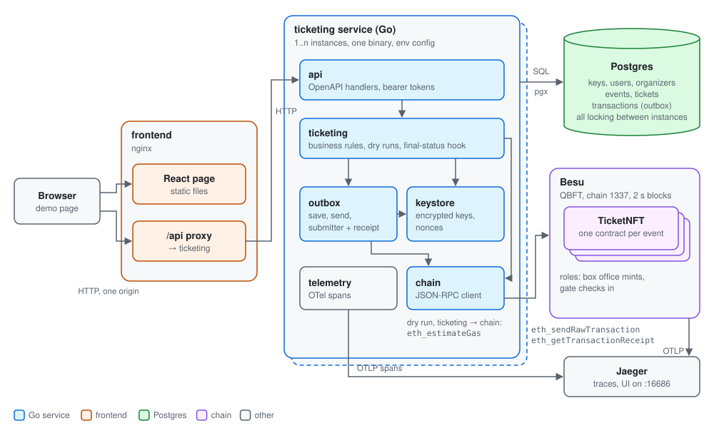
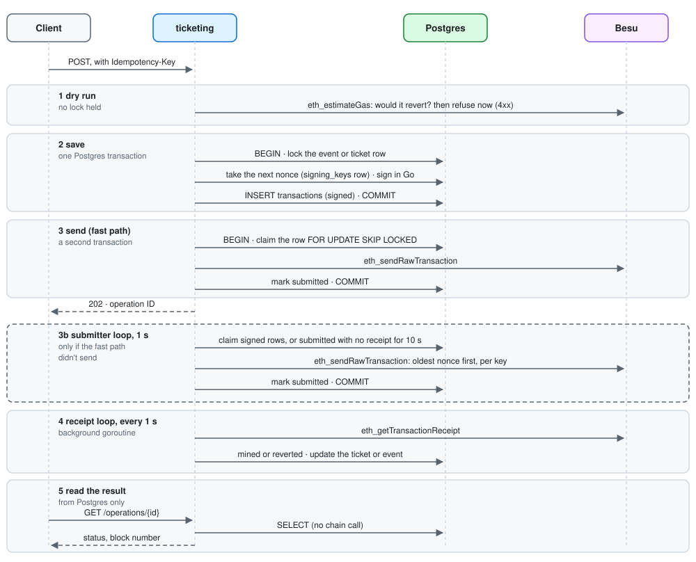
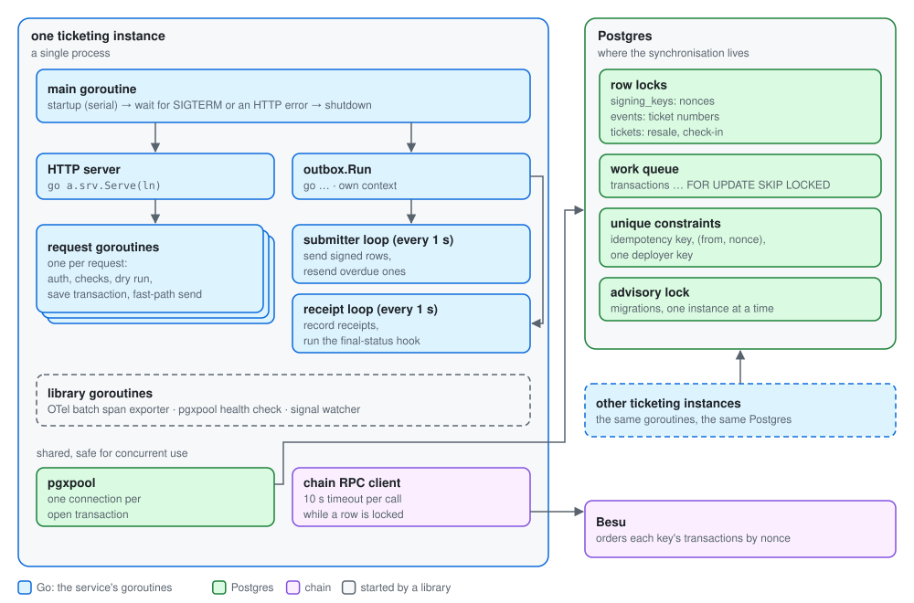

# kaleido-challenge

An event-ticketing service where every ticket is an NFT on a private Besu chain.

## The idea

Organizers create events, users buy tickets, holders resell them under a price
cap, and the organizer's gate checks them in at the door. Each of those steps is
an Ethereum transaction, but nobody using the service needs a wallet, ETH or a
browser extension:

- **The service holds every key.** It creates a signing key for each user (their
  wallet) and three for each organizer (box office, gate, payout), and one
  deployer key for the platform. Keys are stored in Postgres encrypted with
  AES-256-GCM under a key-encryption key that only ever comes from the
  environment.
- **One TicketNFT contract per event.** The deployer deploys it; the organizer's
  box office key holds the minter role and its gate key holds the gate role.
- **The contract enforces the rules**, not just the service:
  - only the box office mints,
  - resale only goes through the contract's own `listForResale` / `buyResale` and never
  above the event's resale cap, ordinary ERC-721 transfers are disabled,
  - a check-in burns the ticket.
- **A check-in needs two signatures.** The holder signs a short-lived pass
  (EIP-712, shown as a QR code); the gate sends it in a transaction it signs
  itself. The contract checks both, so the organizer can't check a ticket in
  without its holder, and a copied pass expires in minutes and works only once.
- **Writes are asynchronous and safe to retry.** Every write answers `202` with an
  operation ID and needs an `Idempotency-Key`. The signed transaction is saved to
  Postgres before it is sent (a transactional outbox), so a crash, a lost
  connection or a down node delays a ticket but never loses or doubles one.

The chain is Besu with QBFT consensus: chain ID 1337, a block every 2 s, zero gas
price. Everything is traced end to end with OpenTelemetry.

## Try it

Needs only Docker. One compose file runs Besu, Postgres, Jaeger, the service and
the demo page; both images are built on the first run:

```bash
export KEY_ENCRYPTION_KEY=$(openssl rand -base64 32) ADMIN_TOKEN=$(openssl rand -hex 16)
```

```bash
docker compose -f docker/docker-compose.yaml up -d --build --wait
```

- Demo page: http://localhost:3000 (creating an organizer asks for `ADMIN_TOKEN`: `echo $ADMIN_TOKEN`)
- Traces: http://localhost:16686 (service `ticketing`)
- API docs: http://localhost:8080/docs

It uses ports 3000, 4317-4318, 5432, 8080, 8545-8546 and 16686; stop anything
already on them first.

## Architecture

### Services and who calls whom

<picture>
  <source media="(prefers-color-scheme: dark)" srcset="docs/img/architecture-dark.svg">
  
</picture>

- **frontend** serves the demo page and forwards `/api/*` to the service, so the
  browser sees one origin.
- **ticketing** is a single Go binary with no files: migrations, the OpenAPI spec
  and the contract bytecode are compiled in, and configuration is environment
  only. Run as many instances as you like against one Postgres.
- **Postgres** is the source of truth for everything off chain, and the place all
  coordination between instances happens.
- **Besu** runs the contracts. The service talks to it only over JSON-RPC.
- **Jaeger** collects traces from both the service and Besu. A request's trace
  context is saved with its transaction, so the background loops' send and
  receipt spans join the request's trace.

### Writes

<picture>
  <source media="(prefers-color-scheme: dark)" srcset="docs/img/write-flow-dark.svg">
  
</picture>

The submitter loop (3b) is the fallback, not the main path. It sends any row the
fast path didn't: Besu was down, the send timed out, or the process died between
COMMIT and send. It also resends the same signed bytes when no receipt arrives
within 10 s, for example after Besu restarts and loses its transaction pool. The
row was committed before the first send, so nothing is ever lost, and a resend
reuses the same nonce, so nothing is ever doubled.

### Reads

Reads never touch the chain. `GET /operations/{id}`, tickets, events, listings and
the ERC-721 metadata are all answered from Postgres, which the receipt loop's
final-status hook updates from each mined result. Postgres is the service's
projection of the chain: within a second or so of the block, it never shows
anything the chain doesn't have, and reads stay fast and keep working while Besu
is down. That holds because nothing changes a ticket on chain except the
service's own transactions: transfers are disabled in the contract and the
service holds every key. With open transfers, it would have to index the
contract's events instead.

### Concurrency map

<picture>
  <source media="(prefers-color-scheme: dark)" srcset="docs/img/concurrency-dark.svg">
  
</picture>

The service code has no mutexes. Every guarantee that matters has to hold across
instances, so each one is a Postgres lock or constraint:

| Guarantee | How |
|---|---|
| Each key's nonces are unique and gapless | `UPDATE signing_keys SET next_nonce = next_nonce + 1 … RETURNING`: the row lock queues requests from the same key; a rollback returns the nonce |
| Ticket numbers are unique, and the last ticket goes to one buyer | `UPDATE events SET tickets_issued = tickets_issued + 1 WHERE … tickets_issued < max_supply` |
| A ticket has one chain action in flight at a time | `SELECT … FROM tickets … FOR UPDATE OF t`, then a check for a resale or check-in still `signed` or `submitted` |
| Each transaction is sent by one worker at a time | `FOR UPDATE SKIP LOCKED` on `transactions`: the fast path and both loops, on every instance, skip rows another holds |
| A retried request never creates a second operation | `UNIQUE (idempotency_key)`: the loser rolls back and returns the winner's result |
| One instance migrates at a time; there is one deployer key | `pg_advisory_lock` around migrations; a partial unique index on the deployer |

**Lock order.** Every write path locks at most one entity row (an event or a
ticket) and then one key row, always in that order, so no two transactions can
wait on each other in a cycle. The loops never wait at all: `SKIP LOCKED` passes
over busy rows.

**Shutdown.** SIGTERM stops the HTTP server first, letting requests in flight
finish their save and send; then the loops finish the pass they are in and stop;
then traces are flushed.

## More

- [docs/milestones.md](docs/milestones.md): how it was built, step by step, with
  the commands for each step
- [docs/layout.md](docs/layout.md): what lives where in the repo
- [docs/dev-tools.md](docs/dev-tools.md): inspecting the chain and the database
- [docs/schema.sql](docs/schema.sql): the full database schema
- [deploy/k8s/README.md](deploy/k8s/README.md): the Kubernetes deployment
